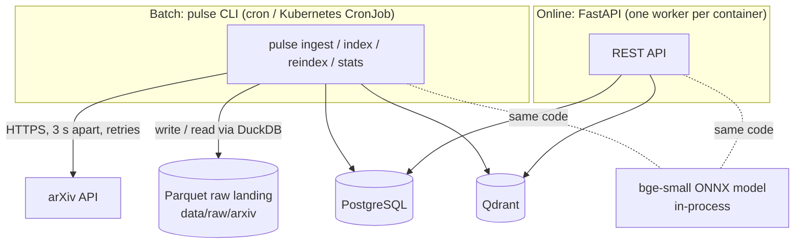
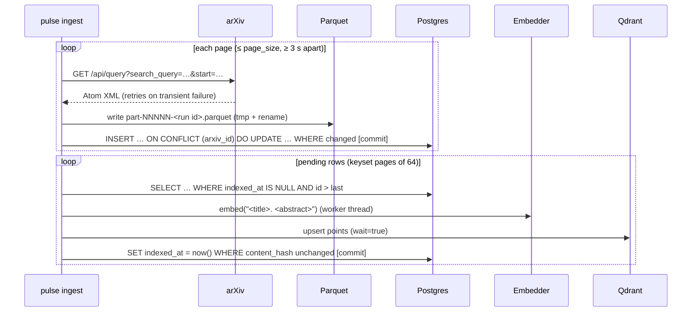

# Architecture

This document explains how the service works and why it is built this way. The README covers
how to run it.

## 1. Components



Both entry points are wired by the same `bootstrap.create_resources()`: engine and pool,
Qdrant client, embedder, vector store. They share all services, so the CLI and the API cannot
drift apart.

| Store | Role | Holds | Rebuildable from |
|---|---|---|---|
| PostgreSQL | Source of truth | `arxiv_papers`, `submissions`, `submission_chunks` | Parquet (papers only) |
| Qdrant | Derived search index | one point per arXiv paper (vector + `arxiv_id`, `title`) | Postgres or Parquet |
| Parquet | Raw landing zone / audit trail | every record each run parsed (not the Atom XML) | arXiv |

## 2. Data model

```
arxiv_papers
  id               bigint PK
  arxiv_id         varchar UNIQUE      -- "2401.12345" (no version suffix)
  version          int                 -- latest version seen
  title, abstract  text
  authors          text[]
  categories       text[]
  primary_category varchar
  published        timestamptz
  source_updated   timestamptz         -- arXiv's <updated>, guards against stale overwrites
  abs_url, pdf_url text
  content_hash     char(64)            -- sha256 of the embedded text
  embedding_model  varchar NULL        -- model of the vector currently in Qdrant
  indexed_at       timestamptz NULL    -- NULL = vector missing/stale (partial index on it)

submissions
  id uuid PK, title text NULL, text text, embedding_model varchar, created_at timestamptz

submission_chunks
  (submission_id uuid FK → submissions ON DELETE CASCADE, chunk_index int) PK
  char_start int, char_end int        -- span in "<title>. <text>"
  vector real[]                        -- 384 floats
```

Qdrant collection `arxiv_papers`: cosine distance, 384 dimensions, point id
`uuid5(NAMESPACE, arxiv_id)`, payload `{arxiv_id, title}` with a keyword index on `arxiv_id`.

## 3. Flows

### 3.1 Ingestion (`pulse ingest`)



How the upsert behaves:
- Insert if new.
- Update only if arXiv's record is newer or the text or version changed.
- Never let older data overwrite newer data (important when replaying old Parquet files).
- Reset `indexed_at` only if the *embedded text* changed. Metadata-only changes (e.g. a new
  category) keep the existing vector.

`RETURNING (xmax = 0)` tells inserts from updates, and skipped rows return nothing, which
gives the inserted / updated / unchanged counts.

### 3.2 Submit (`POST /api/v1/papers`)

1. Pydantic validates the body: `text` required and not blank, `title` optional, extra fields
   rejected. The route enforces the configurable maximum length.
2. `build_embedding_text(title, text)` uses the same rule as for arXiv papers.
3. **Chunking** (worker thread):
   - The model's own tokenizer runs with truncation off and returns character offsets.
   - Windows hold 510 content tokens (512 minus `[CLS]`/`[SEP]`) with a 64-token overlap.
   - A text that fits is a single chunk.
4. All chunks are embedded in one batch (worker thread).
5. **One transaction:** insert `submissions` + `submission_chunks`. Qdrant is not involved.
6. Respond `201 {id, status, chunks, …}` with a `Location` header.

### 3.3 Similar (`GET /api/v1/posts/{id}/similar?limit=k`)

1. Load the submission and its chunk vectors. Unknown → 404; malformed UUID → 422.
2. If the submission was embedded with a different model than the current one, re-embed its
   stored text and save the new chunks (once per submission): vectors from different models
   are not comparable.
3. `query_batch_points`: one Qdrant request containing one query per chunk, each asking for
   `k + 5` hits.
4. **Aggregate (MaxP):** each paper's score is its maximum over chunks. Sort by score
   descending, then `arxiv_id`.
5. Fetch metadata for the ranked ids from Postgres in one `IN (…)` query. Drop ids with no row
   (logged), and cut to `k`.

**Why per-chunk top-k is exact:** suppose paper P belongs in the global top-k with best chunk
c, but is missing from c's top-k. Then k papers score higher than P on c, so each has a best
score above P's, and P cannot be in the global top-k. That is a contradiction. The `+5` only
covers dropped orphans. `tests/unit/test_ranking.py` checks this against brute force on random
data.

The argument assumes each per-chunk search returns its true top-k. Qdrant scans small
collections exhaustively, so that holds for the demo corpus; once a collection is large enough
to be served by HNSW, each search is approximate and so is the aggregated ranking.

## 4. Failure modes

| Failure | Behaviour | Recovery |
|---|---|---|
| arXiv timeout / 5xx / 429 / in-band error / empty page mid-results | Retried with exponential backoff (4 attempts) | Automatic |
| arXiv still failing after retries | Pages already fetched are kept and indexed; CLI exits 1 | Re-run the command |
| Invalid arXiv query (400) | Fails immediately with arXiv's message, no retries | Fix the query |
| Malformed entry in a feed | Logged and skipped; the rest of the page is stored | None needed |
| Crash between Qdrant upsert and `indexed_at` update | Rows stay pending; point already exists | Next `ingest` or `pulse index` overwrites the same point id |
| Text changes while a batch is being embedded | `mark_indexed` matches on `content_hash`, so the stale vector is not marked current | Picked up by the next run |
| Qdrant down during a request | 503 problem+json with `Retry-After`; submissions still accepted (they only need Postgres) | Automatic once Qdrant is back |
| Postgres down during a request | 503 problem+json with `Retry-After` | Automatic (`pool_pre_ping` drops dead connections) |
| Qdrant down at API startup | API starts anyway, `/ready` returns 503 | Automatic |
| Embedding model changed | The collection records its model and dimension; the API and ingestion refuse a collection built with another model, with a clear message | `pulse reindex` |
| Qdrant collection deleted while running | Recreated empty on the next operation (one retry); searches return no matches until reindexed | `pulse reindex --from-db` |
| `pulse reindex` interrupted | Index state is reset in Postgres before the collection is recreated, so every row is pending | Re-run `pulse reindex` or `pulse index` |
| Oversized request body | 413 problem+json before the body is parsed | None needed |

## 5. Decisions and rejected alternatives

| Decision | Chosen | Rejected, and why |
|---|---|---|
| Vector store | Qdrant | **pgvector**: simpler and transactional, but search load would compete with OLTP, and MDPI's stack uses Qdrant. **Qdrant only**: no relational integrity or migrations for submissions and metadata. **MariaDB VECTOR**: newer and less proven for this. |
| Relational DB | PostgreSQL 16 | **MariaDB/MySQL**: viable through the same SQLAlchemy code (dialect plus driver change, and the upsert would use `ON DUPLICATE KEY UPDATE`); Postgres has arrays, partial indexes and `xmax`. |
| Embeddings | bge-small via fastembed (ONNX, local) | **Hosted APIs** (OpenAI, Cohere): need keys and cost money, which breaks "reviewable without purchase". **sentence-transformers**: PyTorch adds GBs to the image. **SPECTER2**: domain-tuned but needs PyTorch + adapters; the best upgrade path. |
| Long texts | Chunk + max per paper | **Truncate to 512 tokens**: silently ignores most of a manuscript. **Average chunk vectors**: dilutes multi-topic texts. **Long-context models** (8k tokens): one vector still dilutes, and slower on CPU. |
| Submission vectors | Postgres `real[]` | **Qdrant collection**: adds a dual write to every request, for vectors that are never searched. |
| Ingestion trigger | CLI command | **Startup task**: slows startup and runs on every replica. **API endpoint**: a long-running, abusable request. **Background worker**: more infrastructure than the task needs. |
| arXiv client | httpx + tenacity + feedparser | **`arxiv` package**: less control over timeouts, retries and arXiv's in-band errors. |
| Raw data | Parquet + DuckDB | **No raw copy**: changing the model would mean calling arXiv again. **dbt**: one transformation does not justify a dbt project. |
| Async stack | FastAPI + SQLAlchemy async + asyncpg | **Sync**: simpler, but I/O-bound request handling scales worse; CPU work goes to threads either way. |

## 6. Production path

How this design would map onto MDPI's Kubernetes, CI/CD and observability setup:

- **Deploy:**
  - The API as a Deployment with readiness/liveness probes on `/ready` and `/health`, scaled
    by replicas.
  - `pulse ingest` as a CronJob.
  - `alembic upgrade head` as a pre-deploy Job (the compose `migrate` service mirrors this).
- **Index rebuilds without downtime:** build `arxiv_papers_v2` next to the live collection,
  then switch a Qdrant collection alias atomically.
- **Raw data:** write Parquet to S3 (`s3://…/run_ts=…/`); DuckDB reads `s3://` paths directly.
- **Long manuscripts:** `POST` returns `202 Accepted` and embedding runs in a worker queue;
  the similar endpoint returns 409 or 202 until the submission is ready.
- **Dual writes:** a transactional outbox (row + "index me" event in one transaction, a worker
  delivers to Qdrant) instead of the pending/indexed state machine.
- **Relevance:** hybrid dense + sparse (BM25/SPLADE) search in Qdrant, a cross-encoder
  reranker over the top 50, per-chunk result diversification, and an offline evaluation set
  to measure every change.
- **Observability:** Prometheus scrapes `/metrics`; alerts on 5xx rate, p95 latency,
  `pulse_arxiv_request_failures_total`, and a growing pending-index count; JSON logs shipped
  with `request_id` for correlation.
